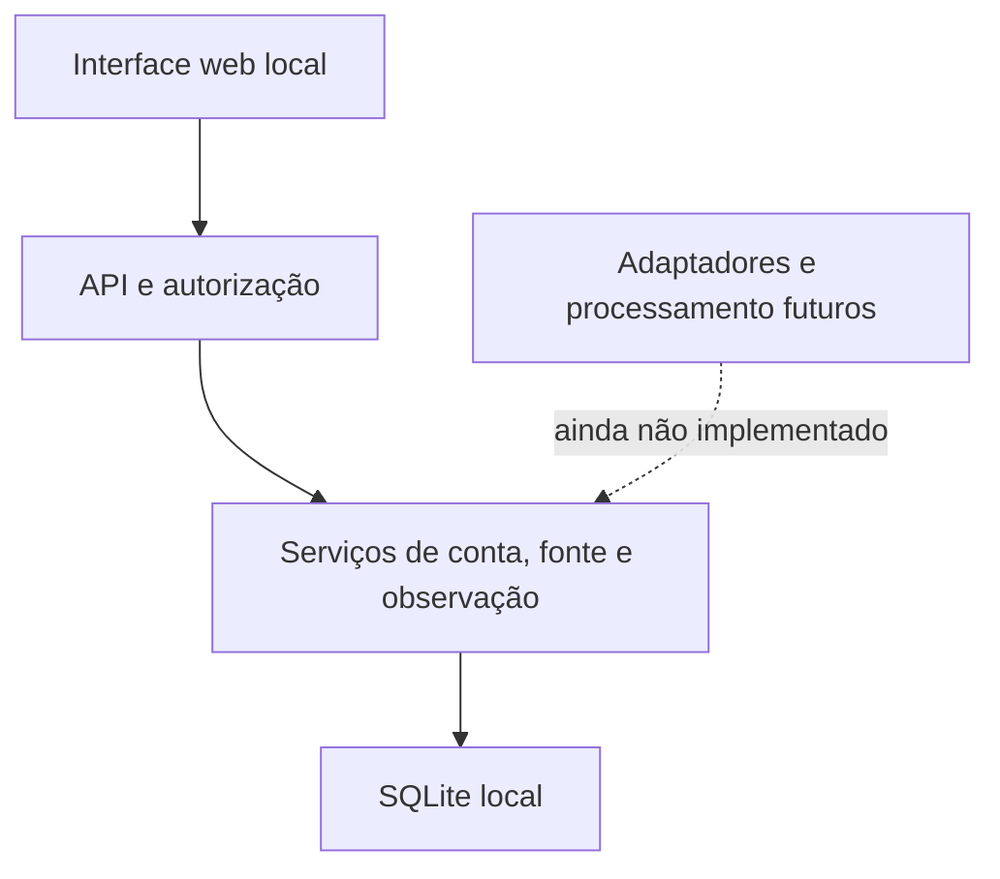

# StormTrack — estrutura revisada do MVP

**Estado:** Incremento 3 — revisão de arquitetura e interface, sem fontes meteorológicas conectadas  
**Escopo:** deixar a aplicação coerente de ponta a ponta sem declarar como implementados serviços que ainda não existem.

## Decisão

O MVP passa a apresentar três áreas reais: **Monitoramento**, **Fontes** e **Auditoria**. O monitoramento é a tela principal e segue a referência visual recebida, mas mantém os dados meteorológicos vazios. Fontes, mapa base, adaptadores, processamento e alertas continuam desconectados enquanto seus termos, formatos, qualidade e métodos não forem analisados.

“Gates aprovados” significam apenas autorização registrada para integração futura. Não significam que existe conexão, coleta, armazenamento operacional ou qualidade validada. A camada visual também não liga nem pausa coleta automática.

## Estrutura encontrada e responsabilidade atual

| Caminho | Responsabilidade existente | Limite atual |
|---|---|---|
| `frontend/index.html` | Login, navegação e composição das três áreas | Sem framework, mapa base ou dados meteorológicos |
| `frontend/styles.css` | Tema, cartões e adaptação para telas menores | Interface própria, servida pela API |
| `frontend/app.js` | Sessão, saúde, catálogo, gates e consulta de logs | Sem SDK de fonte ou processamento no navegador |
| `backend/app/api/main.py` | API FastAPI, autenticação, catálogo, administração, logs e arquivos estáticos | Sem endpoints meteorológicos ou scheduler |
| `backend/app/accounts/` | Hash de senha, sessão, autenticação e limites de contas | Provisionamento local |
| `backend/app/sources/` | Catálogo, transições dos gates e política de fonte | Não implementa conectores |
| `backend/app/observations/` | Persistência interna de observações, deduplicação e revisões | Serviço interno; sem rota HTTP ou coletor |
| `backend/app/core/` | Configuração, segurança e esquema SQLite | Banco local em um único host |
| `tests/` | Regras de fundação, fontes, observações e testes HTTP opcionais | Testes HTTP dependem de FastAPI/HTTPX instalados |
| `docs/` | Decisões, incrementos e diagramas de destino | Os diagramas UML incluem escopo futuro, não código implementado |

## Organização lógica



A interface só conversa com a API local. A autorização é validada no backend, inclusive para operações administrativas. O serviço de observação é chamado internamente e exige produto existente, gates de acesso/coleta/armazenamento verificados, habilitação e referência de evidência.

## Áreas de produto no front

### Monitoramento

- Lista de células vazia e contagem em zero porque não há ingestão nem detector.
- Mapa explicitamente indisponível; não mostra geografia, coordenadas, trilhas, retornos de radar ou cidades inventadas.
- Detalhes de evento, observações, previsão e risco aparecem como indisponíveis/não emitidos.
- Radar, satélite, raios, estações e modelos aparecem como candidatos a avaliar, desconectados.
- Maringá permanece como foco de produto planejado, sem distância, previsão ou declaração de segurança sem observações reais.

### Fontes

- Catálogo existente, com cadastro administrativo e atualização auditável dos quatro gates.
- Estado habilitado é descrito como autorização futura, nunca como sinal de coleta em andamento.
- Fonte sem avaliação fica pendente/desativada; não há conexão externa.

### Auditoria

- Logs administrativos existentes, visíveis apenas ao Administrador.
- Auditoria de ingestão automática começa a ter registros quando houver um coletor controlado.

## Persistência existente

O SQLite já contém contas, sessões, fontes/produtos, logs, artefatos, observações, revisões append-only, avaliações de qualidade e verificações de saúde da fonte. Esse esquema dá uma base para proveniência e deduplicação; não significa que saúde e qualidade estejam sendo atualizadas por uma integração.

## O que ainda falta antes de dados meteorológicos reais

1. Selecionar um produto de fonte e registrar documentação oficial, termos, atribuição, limites de acesso e redistribuição.
2. Analisar o formato e a semântica do produto, cobertura, resolução, atraso, timestamps, unidades e política de correção.
3. Definir e aprovar o contrato canônico de ingestão, validações, tratamento de lacunas, duplicatas, retries e limites de payload.
4. Implementar um adaptador isolado e testes com amostras autorizadas, sem dependência da interface.
5. Executar ingestão em modo controlado, conferir proveniência e qualidade, e observar falhas e recuperação.
6. Só então expor observações em endpoints de leitura e conectar uma camada de mapa apropriada.
7. Definir algoritmos e validação meteorológica em incremento separado antes de exibir células, trajetórias, risco ou nowcast.

## Estrutura recomendada para os próximos incrementos

Adicionar módulos somente ao implementar a primeira integração, mantendo limites claros:

```text
backend/app/
  api/                 rotas e modelos de transporte
  accounts/            identidade e sessões
  sources/             catálogo, gates e políticas
  observations/        domínio canônico e persistência
  ingestion/           orquestração, agendamento e estado de execução
  adapters/<provider>/ conversores específicos, sem regras de UI
  analysis/             métodos versionados e resultados derivados
  alerts/               regras, entregas e proveniência de alertas
  core/                 configuração, segurança e banco
tests/
  unit/                 regras e validadores
  integration/          adaptador, banco e contratos
  fixtures/             amostras autorizadas e anonimizadas
```

`ingestion/`, `adapters/`, `analysis/` e `alerts/` são destino recomendado, não componentes presentes neste incremento. Cada fonte deve ter timeout, limite de resposta, validação de esquema, deduplicação, retry controlado e health check próprios. Uma fonte não deve importar ou alterar a camada de apresentação.

## Riscos e critérios de aceite desta revisão

- **Risco de interpretação:** a imagem de referência mostra conteúdo ao vivo; todos os valores numéricos e eventos da imagem foram omitidos.
- **Risco operacional:** produto habilitado ainda pode ser confundido com feed ativo; mensagens do painel deixam clara a diferença.
- **Risco de escopo:** diagramas de destino descrevem funcionalidades além do MVP atual; devem ser tratados como arquitetura planejada até haver código, testes e documentação de validação.
- **Aceite:** navegação separa as três áreas; o perfil usuário não vê auditoria/administração; fontes ainda pendentes não são chamadas; estado vazio explica a limitação; saúde da API/banco continua visível.

## Conclusão técnica

A estrutura atual é adequada como fundação local do MVP, mas não está pronta para monitoramento meteorológico operacional. O próximo incremento técnico deve escolher e auditar **uma única fonte/produto**, em vez de ativar todas as camadas da referência ao mesmo tempo. Isso reduz o risco de misturar permissões, formatos, qualidade e semântica de provedores diferentes.
