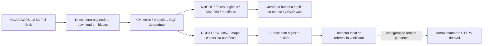

# GOES multicamadas e pesquisa local — 05/11/2026

Implementação aditiva sobre FastAPI, Leaflet e `regional_satellite.py` existentes.
As alterações anteriores do workspace foram preservadas. Sem commit, push,
deploy, migração remota, treinamento ou inferência. Não foi encontrado AGENTS.md
nas raízes consultadas ou nos diretórios de código.

## Executar no PowerShell

Na pasta `StormTrack`, use o ambiente `.venv` existente:

```powershell
.venv\Scripts\python.exe -m uvicorn backend.app.api.main:app --host 127.0.0.1 --port 8000
.venv\Scripts\python.exe -m backend.app.adapters.regional_satellite --profile basic
```

Execute servidor e coletor em terminais distintos. O coletor usa a trava SQLite
existente; abrir abas não inicia outro coletor. O perfil básico mantém C13 e GLM.
**Mudança explícita de orçamento:** novos quadros básicos usam C13 em cinza como
base da opção combinada, com indicação no painel. Os RGB já armazenados e a
preferência do usuário continuam preservados. True Color e demais receitas
permanecem sob demanda. Para manter a coleta RGB anterior continuamente:

```powershell
$env:STORMTRACK_SATELLITE_COLLECT_RGB='true'
.venv\Scripts\python.exe -m backend.app.adapters.regional_satellite --profile basic
```

Isso pode baixar cerca de 600 MB por cena devido ao C02 Full Disk, mesmo que o
recorte final tenha apenas 900 pixels de largura. Não é o padrão econômico.

```powershell
.venv\Scripts\python.exe -m backend.app.adapters.regional_satellite --profile convective
$env:STORMTRACK_SATELLITE_RECIPES='simple-vapor,split-window,phase'
```

Defina variáveis **antes** de iniciar o processo. O perfil convectivo acrescenta
C08/C09/C10/C11/C13/C15 e dependências das receitas escolhidas; mantém a composição
diurna anterior. O perfil research coleta os 16 canais e exige `--until` em UTC,
no máximo seis horas à frente. Para pesquisa reproduzível, prefira o exportador,
que fixa seus insumos fora do cache descartável.

```powershell
.venv\Scripts\python.exe -m backend.app.adapters.goes_layers --start 2026-11-05T19:30:00Z --end 2026-11-05T19:31:00Z --output output/minha-sessao --profile research --estimate
.venv\Scripts\python.exe -m backend.app.adapters.goes_layers --start 2026-11-05T19:30:00Z --end 2026-11-05T19:31:00Z --output output/minha-sessao --profile research --event-id evento-curado-pelo-usuario
```

Substitua as datas para outras sessões. O intervalo máximo é seis horas UTC;
pastas existentes são recusadas para proteger datasets. `--channels 8,10,13,15`
substitui o perfil. Sem observação, há erro e manifesto incompleto, nunca amostra
negativa fabricada. `--estimate` consulta tamanhos reais, sem baixar os discos;
não inventa estimativa de tempo sem throughput medido.

## Fluxo e responsabilidades



`goes_layers.py`: grafo, aquisição compartilhada por scan, 16 canais, diferenças,
receitas e exportação. `goes_products.py`: leitores L2 e seus flags reais,
consulta nativa de perfis e vetores. `research_samples.py`: sequências, patches,
variação Euleriana, estrutura COCO e validação humana. `satellite_artifacts.py`:
contrato local de publicação e cliente HTTPS explícito; não publica sozinho.

Os downloads e os campos físicos ABI são reutilizados entre receitas dentro da
mesma cena. Fontes transitórias não ficam na RAM inteira: C02 de 402 MB é gravado
em blocos de 1 MiB; o hash também é calculado em blocos. A leitura NetCDF recorta
a região antes da amostragem. PNGs não são os tensores de treinamento.

## Física, geografia e visualização

- Fonte GOES-19, ABI-L2-CMIPF Full Disk; identidade e band_id conferidos no arquivo.
  GOES-19 consta como Operational East na página OSPO consultada.
- Valores científicos C01–C06 em fração de reflectância, C07–C16 em K. A escala
  NetCDF é aplicada uma vez pelo leitor. CMI não recebe conversão Planck.
- O C13 em °C usado pela interface anterior permanece compatível; no exportador
  científico as temperaturas voltam a K. Diferenças espectrais usam K.
- Grade do mapa EPSG:3857, 900 pixels de largura, coordenadas dos centros, nearest
  neighbor, sem correção de paralaxe. É uma grade de visualização/pesquisa
  configurada pelo recorte; não é a resolução nativa nem uma promessa de 500 m.
- A extensão padrão é −68,−39,−44,−18. Os testes usaram caixas de PR, SC, RS,
  Paraguai, Uruguai e Argentina norte/NE, não polígonos oficiais de risco.
- Canais visíveis ficam no-data quando o cosseno solar aproximado é ≤0. Receitas
  diurnas exigem cosseno >0,1; a microfísica noturna exige <0. A geometria solar é
  aproximada e declarada; não há correção Rayleigh ou solar escondida.
- A nova paleta C13 é uma receita visual local v1, não a paleta Meteologix. Nós
  em °C: −100,−80,−70,−60,−50,−40,−30,40. Extremos frios vermelhos, passando por
  amarelo, verde, ciano e azul; acima de −30, cinza. O overlay passa de transparente
  em −30 a opaco em −40. Imagem e legenda usam a mesma tabela. Extremos saturam
  nas cores terminais; pixels inválidos são transparentes. A legenda anterior
  permanece própria e é restaurada ao voltar ao estilo anterior.
- DQF CMIP aceita apenas código 0. L2 usa enums, bits e flags de recuperação
  específicos, conferidos nos arquivos. TPW/DSI exigem DQF Overall, Retrieval e
  SkinTemp válidos; lacunas sob nuvens são conservadas.
- Campos L2 contínuos usam escala de exibição nos percentis 2–98 válidos do
  recorte, informada na interface; seus valores físicos não são alterados.
  Categorias usam nearest e cores discretas; o clique informa o código.

## Receitas e dependências

A matriz gerada em `GOES_MATRIZ_CAMADAS.md` enumera canais, receitas e produtos.
As tuplas de `RGB` em `goes_layers.py` são a receita executável versionada:
expressões por componente, limites inferior/superior, gamma e condição solar.
Diferenças mantêm a ordem explícita C13−C15, C13−C07, C11−C14, C08−C10,
C12−C13 e C08−C13. A máscara de cada diferença é a interseção das entradas.

True Color usa verde sintético linear 0,45 C02 + 0,10 C03 + 0,45 C01 e gamma 2,2.
É a variante de reflectância bruta, sem correção atmosférica, não GeoColor.
Day Land Cloud corresponde à família Natural Color; não é uma nova observação
independente. Day Snow/Fog usa C07−C13 como proxy documentado da componente solar.
Fire Temperature é limitado ao dia porque seus canais refletivos estão sujeitos
à máscara noturna desta implementação. RGBs são produtos de exibição correlatos
aos canais, não mais entradas independentes por si sós.

Referências primárias conferidas:

- [OSPO: status GOES](https://www.ospo.noaa.gov/operations/goes/status.html)
- [Satpy: composições ABI](https://github.com/pytroll/satpy/blob/main/satpy/etc/composites/abi.yaml)
- [Satpy: realces ABI](https://github.com/pytroll/satpy/blob/main/satpy/etc/enhancements/abi.yaml)
- [Guias CIRA](https://rammb.cira.colostate.edu/training/visit/quick_guides/)
- [NOAA: dados públicos GOES](https://registry.opendata.aws/noaa-goes/)

## GLM e tempo

O coletor de flashes existente foi reutilizado. O endpoint autenticado aceita
`/api/satellite/regional/flashes?end=<ISO UTC>&minutes=1|5|10|15`. Taxa só é
fornecida quando a cobertura temporal é ≥98%; dados ausentes não viram zero.
O seletor de janela usa o fim da cena escolhida. O replay e a preferência de
produto sobreviveram ao teste JavaScript, sem deslocar a pausa para o presente.

Não foi implementada FED por histograma de centroides, nem área arbitrária por
flash. FED/MFA/AFA/TOE de extensão dependem de footprints/eventos e validação do
método. A deduplicação existente é por arquivo+flash_id; a identidade de flashes
que atravessam arquivos e revisões ainda exige auditoria. Não se declara este
passo concluído. Pontos GLM não significam impacto no solo.

## Pesquisa e anotações

Cada sessão inclui NetCDF CF com coordenadas lon/lat, máscara NaN, unidades,
fontes originais, hashes SHA-256 e manifesto versionado. O manifesto registra
intervalos, grade/transformada, fração válida, configuração e tempos conhecidos.
A disponibilidade original da fonte fica null com motivo. Revisão científica
é hash do arquivo; IDs de cena, amostra, sessão e evento são separados nas novas
exportações. Exportações iniciais anteriores ao ajuste do schema conservam seu
manifesto original como evidência; não foram reescritas para inventar metadados.

`research_samples.causal_sequence` seleciona sequências por **fim da observação**,
sem reutilizar cena ou aceitar dados posteriores à referência. Faltas geram
sequência incompleta. `eulerian_change` usa Δt real, interseção de máscaras e
grade idêntica; não acompanha células. `patches` conserva a transformada local.

`annotations.coco.json` começa vazio e pendente; a categoria é candidato
convectivo. Uma anotação importada precisa de anotador e estado uncertain/reviewed.
Topo frio extenso não define célula individual. Limiar térmico é pseudo-rótulo,
não referência humana. Não há caixas fictícias, modelo escolhido ou pesos.

`validate_splits` bloqueia evento/cena/hash repetidos e proximidade temporal
configurada entre splits. **Ainda não faz análise geométrica entre eventos
distintos**, nem detecta por si só que um sistema meteorológico ganhou outro ID.
Curadoria deve agrupar sobreposições, derivados e reprocessamentos antes do split.
Normalização é planejada apenas no treino. `experiments.json` descreve comparações
futuras de C13, IR/vapor e informação diurna, sem treinamento.

Planejar positivos, negativos e casos difíceis: cirrus, estratiformes, bigornas,
fumaça, fogo, dia/noite, terminador e falhas. São categorias de curadoria, não
declaração de exemplos anotados já coletados. YOLO ainda não foi implementado.

## Orçamento e retenção

Padrões: um trabalhador, descoberta ABI 120 s, GLM 60 s, retenção de duas horas,
cache descartável 512 MiB, reserva livre 256 MiB. O intervalo de descoberta não
altera o intervalo de observação. Sessões fixadas ficam fora do cache e têm cota
de fontes de 2 GiB (`STORMTRACK_RESEARCH_MAX_BYTES`), pausando com erro ao exceder.
Os insumos de sessões não são apagados pelo coletor. Não há envio do arquivo bruto
para Vercel ou Supabase. Perfis avançados podem atingir a cota e parar; use a
estimativa e exportações delimitadas para o corpus.

Medições desta máquina, com a região completa e fontes Full Disk:

| Ensaio | Fontes | Tempo total | CPU do processo | Pico RAM | Disco inicial |
|---|---:|---:|---:|---:|---:|
| C08/C10/C13/C15 diurno | 92,4 MB | 42,1 s | 4,0 s | não medido | 112,5 MB |
| C07/C13/C15 noturno | 75,8 MB | 43,7 s | 3,2 s | não medido | 94,9 MB |
| C02/C05/C13 diurno | 512,5 MB | 119,7 s | 8,5 s | 461,2 MB | 532,5 MB |
| Todos os 16 canais | 929,1 MB | 286,3 s | 21,6 s | 411,6 MB | 970,4 MB |

MB decimais. Fontes incluem download Full Disk, mesmo com recorte precoce. Não
confundir CPU-segundos com percentual de uso total do computador. O disco medido
é anterior aos previews adicionais. O custo horário não foi medido em execução
contínua; 6 cenas/h dos 16 canais projetariam aproximadamente 5,57 GB/h de fontes,
o que justifica deixar pesquisa completa fora do padrão. C13 sozinho da cena
mediu 24,9 MB de fonte. Não é promessa de throughput para outros PCs ou cenas.

## Evidências locais e limites de aceite

- `output/goes-inventory.json`: listagem paginada real dos produtos e amostras.
- `output/goes-products-real.json`: variáveis, unidades e flags dos arquivos L2.
- `output/goes-research-real-day`, `goes-research-real-night`,
  `goes-research-real-visible-v2`, `goes-research-all16`: fontes, manifesto,
  NetCDF e previews reais. `goes-research-real-visible` conserva a tentativa
  incompleta que identificou o limite antigo de C02; não é amostra utilizável.
- `output/goes-validation.json`: reprodução exata dos arrays a partir dos
  insumos, cobertura por caixas regionais, exportações L2 e leitores nativos.
- Perfis LVT/LVM: 101 níveis reais em Maringá; os valores do ponto testado ficaram
  ausentes após qualidade, preservando a lacuna. Vetores: 997 DMW e 58 DMWV na
  região e referência verificadas. Esses leitores ainda não têm controles no mapa.
- Previews foram inspecionados diretamente. O teste JS cobre replay, GLM, legenda,
  expansão e preferência. **Não houve validação visual do aplicativo inteiro em
  navegador desktop/celular**, alinhamento de litoral sobre basemap ou auditoria
  científica independente. Os testes são de engenharia, não de meteorologia.

Nenhum arquivo foi encontrado na janela consultada de RRQPEF, GFLSF, VAAF e SSTF.
Isso significa ausência naquela janela, não inexistência definitiva do prefixo.
Perfis e vetores têm leitor numérico real, mas integração cartográfica pendente.
O exportador de sessões atualmente fixa ABI; L2 e perfis/vetores possuem exports
separados de verificação. Sessões multimodais ABI+GLM+L2, coleção GLM de
eventos/grupos, produtos GLM avançados e publicação remota operacional permanecem
pendentes. Portanto, **o escopo integral do prompt ainda não tem aceite completo**.

## Local e online

O aplicativo publicado existente serve os próprios endpoints FastAPI e o banco
configurado. O catálogo regional é desativado em serverless; não aponta navegador
remoto para localhost. Não foi encontrado receptor remoto durável para tiles e
valores científicos. O contrato implementado constrói bundle sem segredos e sem
arquivo bruto; o receptor local verifica tamanho, nomes e SHA-256, persiste todos
os arquivos, depois anuncia a revisão. Há cliente HTTPS explícito com identidade
de máquina e confirmação da revisão, mas nenhum envio foi executado.

Ainda é necessário configurar um receptor autenticado, armazenamento durável,
URLs de leitura e integração do catálogo online com a mesma revisão. Os testes
locais não comprovam persistência em Vercel. Não foram abertas portas domésticas,
alteradas credenciais, chaves administrativas ou infraestrutura remota.

## Verificar e desativar

Resultado final da regressão: **109 testes passaram, 7 ignorados, 55 subtestes
passaram**, em 23,63 s. Há avisos de depreciação já existentes de Starlette/httpx
e NumPy/NetCDF. O teste JavaScript e a análise de sintaxe passaram. Um bundle de
cena real foi recebido localmente com confirmação após persistência em
`output/satellite-receiver/`; não houve upload remoto.

Não foram adicionadas dependências: foram reutilizados NumPy, netCDF4, Pillow,
pyproj, httpx e pytest do ambiente existente. Novos módulos: `goes_layers.py`,
`goes_products.py`, `research_samples.py`, `satellite_artifacts.py` e os scripts
de inspeção, validação e geração da matriz. Alterações aditivas: API, coletor,
controles/CSS regionais, teste JS, `.env.example`, README e testes novos.

```powershell
.venv\Scripts\python.exe -m pytest -q -p no:cacheprovider
.venv\Scripts\python.exe -m backend.app.scripts.validate_goes_extension
```

O validador real exige os artefatos acima. Seu teste offline conserva as fontes
originais. A suíte precisa de acesso aos diretórios temporários normais do Windows;
o sandbox inicial bloqueou esse acesso, e os testes passaram fora dele.

Para desativar só a extensão regional, pare seu coletor, defina
`STORMTRACK_SATELLITE_ENABLED=false` e reinicie o servidor. As funções anteriores
do StormTrack permanecem disponíveis. Não use `git reset` para reverter: havia
alterações locais anteriores. Os arquivos novos são separáveis; remova somente
as adições desta extensão após revisar o diff. Não houve migração do banco de
contas, eventos ou alertas; os datasets em output/data não precisam ser apagados.
