# StormTrack — Caso de Uso, Classes, Sequências e DER

**Versão:** 1.3 — alinhamento com sessões e persistência append-only  
**Estado:** rascunho técnico sob revisão; não aprovado como especificação final nem como autorização para implementar funções meteorológicas. Os gates de método e de fonte continuam pendentes.

## 1. Decisões que governam os diagramas

- Piloto local com **cinco contas no total**: uma conta Administrador e até quatro contas Usuário Registrado. Sem cadastro público e sem CRUD completo de usuários.
- Contas locais e autorização no backend. O backend valida o perfil também em cada operação protegida.
- Sessões locais expiram e podem ser revogadas; persistência guarda somente o digest do token, nunca o token em claro. A interface mantém o token apenas na sessão da aba do navegador.
- Fonte/produto só entra em coleta automatizada com condição de acesso verificada. Licença/termos da fonte são independentes da aprovação meteorológica.
- Armazenamento em UTC, preservação do timestamp e offset originais, deduplicação por chave definida por produto e revisões append-only.
- Métricas de qualidade, confiança do tracking e confiança do perigo são distintas. Valor desconhecido permanece ausente.
- CELL-ID e linhagem preservados em split/merge conforme evidência de continuidade; novas identidades guardam relação pai/filho.
- Nowcast registra decisão por método, célula, estado-base confiável e horizonte. A não emissão tem motivo; emissão tem horário de emissão separado do horário-base.
- Proveniência distingue natureza da saída, insumos usados e método/versão.
- Validação compara previsão com observação posterior e armazena desempenho de convencional, IA e ensemble separadamente.
- Replay visual é consulta histórica. Reprocessamento simulado usa escopo isolado.
- Alertas oficiais e alertas experimentais StormTrack permanecem distinguíveis.
- MVP local-first: recuperação de falhas parciais é prevista; alta disponibilidade não é prometida além do limite de host e banco únicos.

## 2. Caso de uso

| ID | Caso de uso | Ator | Resultado |
|---|---|---|---|
| UC-01 | Autenticar-se | Usuário Registrado, Administrador | Sessão local autorizada pelo perfil. |
| UC-02 | Consultar monitoramento | Usuário Registrado, Administrador | Mapa, CELL-ID, mudanças relevantes, trajetória, evidências, riscos independentes e alertas separados por origem. |
| UC-03 | Consultar nowcast | Usuário Registrado, Administrador | Horizontes emitidos ou motivo de não emissão. |
| UC-04 | Consultar Maringá Focus | Usuário Registrado, Administrador | Consulta da zona ativada automaticamente quando aplicável, com distância, movimento, riscos, nowcast, tendência, confiança e alertas disponíveis. |
| UC-05 | Inspecionar camadas | Usuário Registrado, Administrador | Inspeção visual; não controla processamento. |
| UC-06 | Consultar replay visual | Usuário Registrado, Administrador | Leitura de registros históricos sem reprocessamento. |
| UC-07 | Configurar fontes e regiões | Administrador | Configuração de fontes, regiões e somente parâmetros/métodos já aprovados para operação. |
| UC-08 | Consultar saúde e logs | Administrador | Estado operacional e registros técnicos. |
| UC-09 | Executar simulação isolada | Administrador | Reprocessamento em execução e escopo distintos do modo ao vivo. |
| UC-10 | Consultar validação do nowcast | Usuário Registrado, Administrador | Consulta básica de erro/desempenho por método, alvo e horizonte; sem exportação de relatório avançado. |

Fontes meteorológicas e serviços oficiais são integrações externas, não atores humanos. Coleta e análise automáticas são comportamentos internos acionados pelo scheduler.

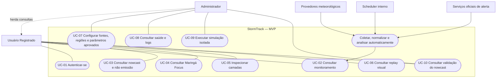

**Regra de acesso:** no máximo cinco contas locais provisionadas para o piloto, com uma conta Administrador e até quatro Usuários Registrados. O limite é de configuração/política do piloto; não cria cinco atores no UML.

## 3. Diagrama de classes

### 3.1 Identidade, fontes e dados

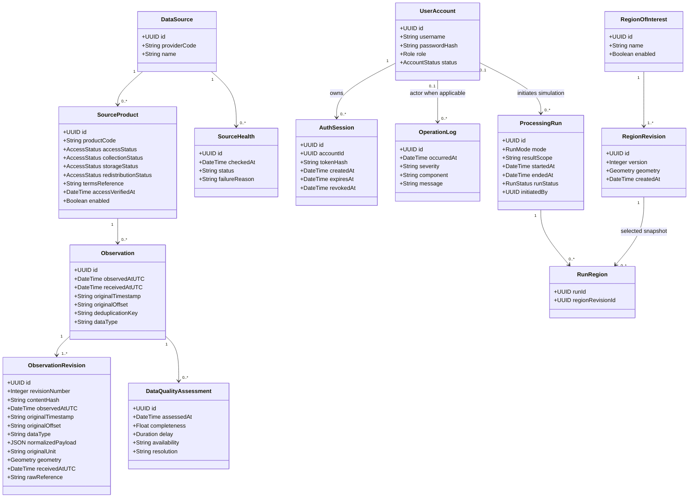

### 3.2 Células, métodos e resultados

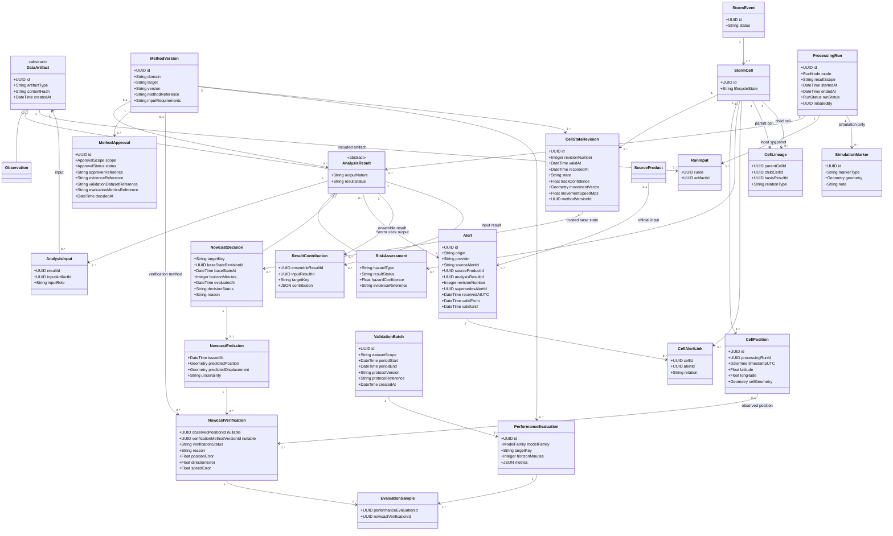

**Regras de classe:** resultados são append-only e apontam para método/versão e execução. `NowcastDecision` existe também para `NOT_EMITTED`, com motivo; só `EMITTED` tem `NowcastEmission`. Riscos e status de qualidade são independentes. `CellLineage` liga explicitamente célula pai e filha. Alertas usam associação muitos-para-muitos.

## 4. Diagramas de sequência

### 4.1 Autenticação e autorização

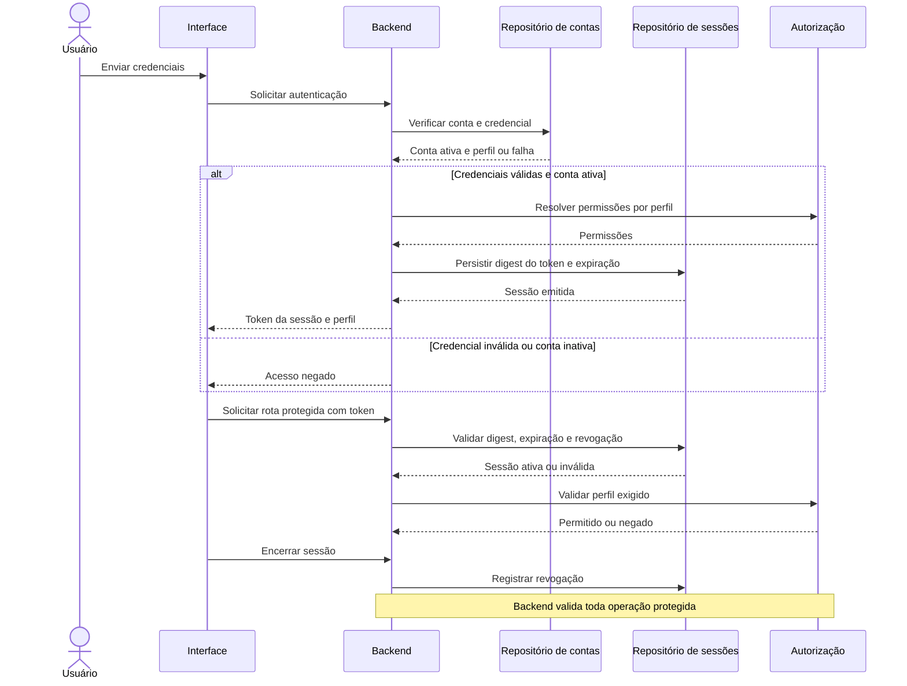

### 4.2 Coleta, deduplicação e persistência

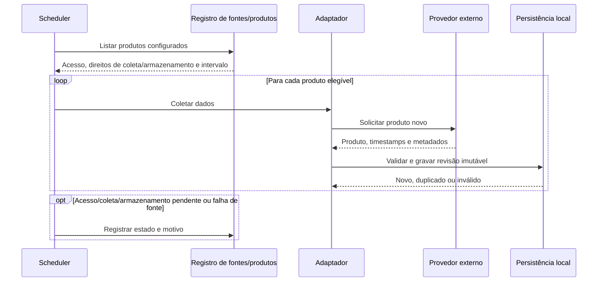

### 4.3 Análise independente por método e horizonte

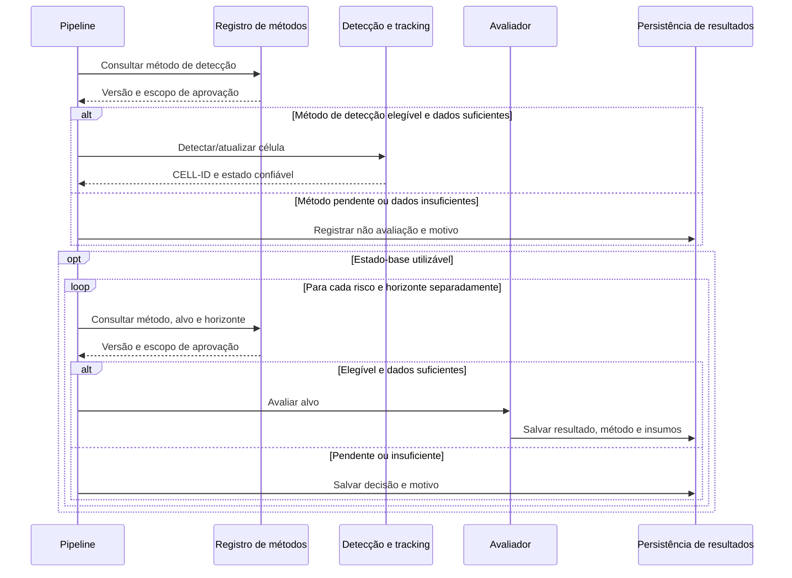

### 4.4 Consulta do monitoramento e validação

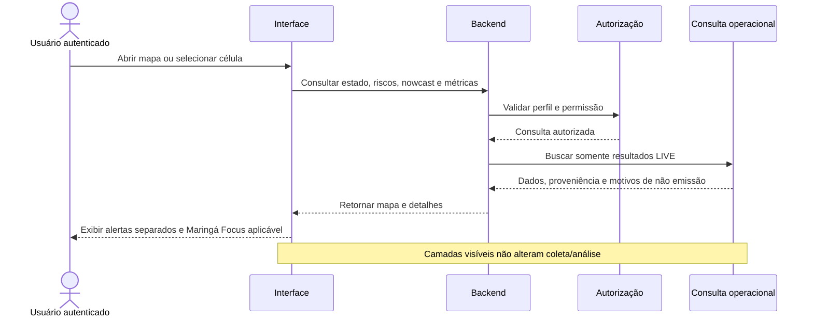

### 4.5 Verificação e comparação de desempenho

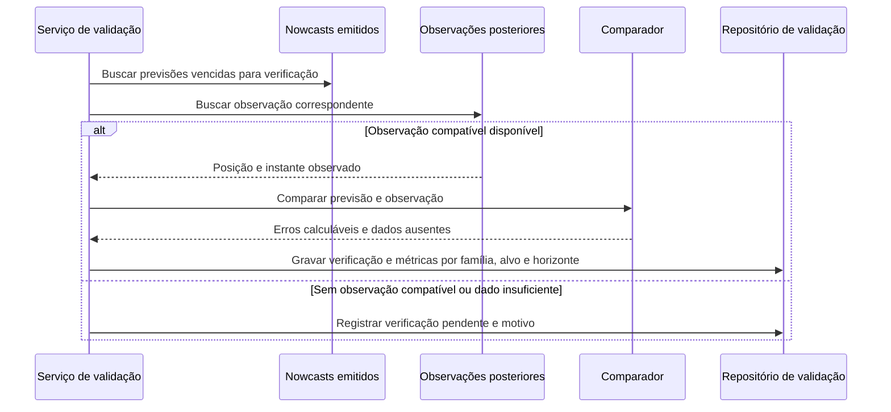

### 4.6 Replay visual e simulação

#### Replay visual

```mermaid
sequenceDiagram
    actor User as Usuário
    participant UI as Interface
    participant API as Backend
    participant AuthZ as Autorização
    participant History as Histórico operacional
    User->>UI: Selecionar célula e período
    UI->>API: Solicitar replay visual
    API->>AuthZ: Validar sessão e perfil
    AuthZ-->>API: Consulta autorizada
    API->>History: Buscar dados LIVE do período
    History-->>API: Observações e resultados imutáveis
    API-->>UI: Retornar sequência temporal
    UI-->>User: Exibir replay visual
    Note over API,History: Nenhum método é reexecutado; SIMULATION é filtrado
```

#### Simulação isolada

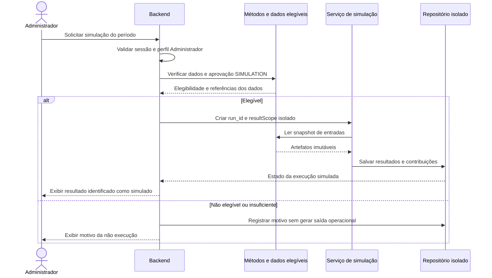

Replay visual lê dados históricos operacionais e não reexecuta métodos. Simulação exige elegibilidade explícita no escopo `SIMULATION`; cria `ProcessingRun(mode=SIMULATION, resultScope=<run_id>)`; não atualiza o escopo `LIVE`. O marcador Ponto I, se usado, pertence somente à simulação.

## 5. DER lógico

O DER é separado em três vistas para leitura. `DATA_ARTIFACT` permite que observações e resultados sejam referenciados como insumos sem perder a chave estrangeira. Geometrias usam o CRS interno definido pela implementação; timestamps persistidos são UTC e preservam o valor/offset original.

### 5.1 Acesso, fonte e proveniência

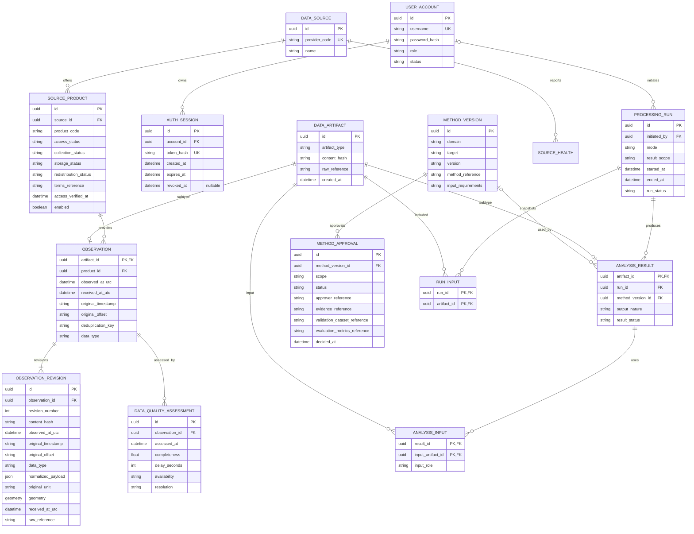

### 5.2 Evento, célula, risco, nowcast e alertas

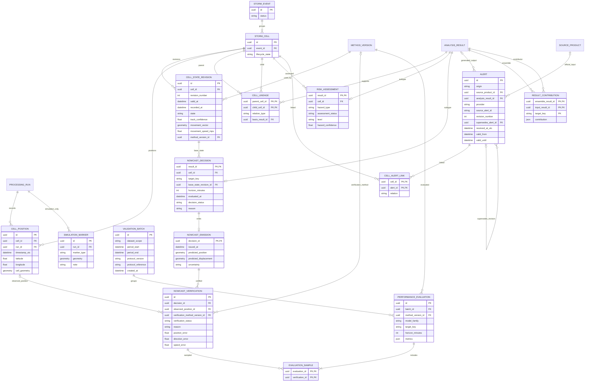

### 5.3 Regiões e operação

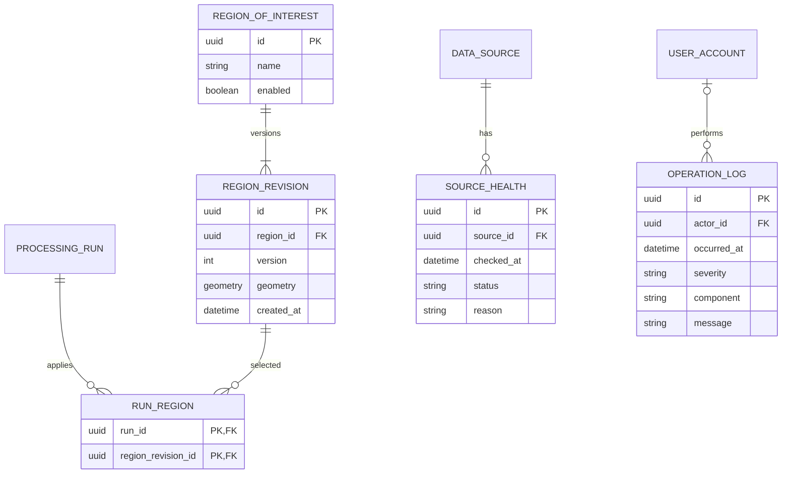

## 6. Restrições de integridade e operação

1. **Contas:** username único; senha armazenada apenas como hash; perfil controlado por enum. Máximo de cinco contas provisionadas no piloto; uma conta Admin e até quatro contas User. A criação inicial é provisionamento local, não cadastro público.
2. **Deduplicação:** chave única no escopo do produto; guardar chave/hash do provedor quando disponível. A fórmula exata é configurada por produto, não globalmente presumida.
3. **Imutabilidade:** observações recebidas, revisões, decisões e resultados são append-only. Correção gera nova revisão/execução com vínculo à versão anterior, sem sobrescrever a evidência usada.
4. **Isolamento:** todo resultado pertence a `PROCESSING_RUN`; APIs operacionais filtram `LIVE`. Reprocessamento usa novo `run_id` e `result_scope` próprio.
5. **Nowcast:** uma decisão é identificada por célula, versão do método, estado-base e horizonte. A tabela aceita `NOT_EMITTED` com motivo; emissão e previsão só existem quando status é `EMITTED`.
6. **Ensemble:** cada contribuição referencia resultado de entrada e `target_key`; compatibilidade do alvo e regra de combinação precisam estar aprovadas.
7. **Falhas:** uma fonte indisponível não interrompe as demais. Saúde, falha e recuperação ficam registradas. Infraestrutura segue limite explícito de host/banco único.
8. **Alertas:** `origin` separa oficial e StormTrack. Alerta oficial referencia `SOURCE_PRODUCT`; alerta StormTrack referencia `ANALYSIS_RESULT`. A origem determina qual vínculo é obrigatório; nunca apresentar alerta experimental como oficial.
9. **Ponto I:** persistir como `SIMULATION_MARKER` ligado a uma execução `SIMULATION`; não exibir como alvo operacional nem como orientação de aproximação.

### Estados estruturais

Estes estados controlam o fluxo técnico; não são limiares meteorológicos:

- `role`: `USER`, `ADMIN`; conta: `ACTIVE`, `DISABLED`.
- fonte/produto: estados independentes para acesso técnico, coleta automatizada, armazenamento e redistribuição. Coleta local só com acesso técnico, coleta e armazenamento verificados e produto habilitado.
- execução: `LIVE`, `SIMULATION`; escopo de resultados separado por `run_id`.
- aprovação de método: escopo `LIVE` ou `SIMULATION`; situação `PENDING`, `APPROVED`, `REJECTED`, `RETIRED`.
- decisão de nowcast: `EMITTED`, `NOT_EMITTED`, `NOT_EVALUATED`. `NOT_EMITTED` significa método avaliado sem emissão; `NOT_EVALUATED` significa bloqueio/insuficiência. Ambos exigem motivo. Só `EMITTED` pode ter geometria prevista.
- rotação: estados `DETECTED`, `NOT_DETECTED`, `UNAVAILABLE`, `INSUFFICIENT`; ausência de Doppler/dado adequado não equivale a `NOT_DETECTED`.
- natureza da saída: `OBSERVED`, `DERIVED`, `FORECAST`, `AI_EXPERIMENTAL`, `OFFICIAL`; origem dos insumos fica em `ANALYSIS_INPUT`, e método/versão em `METHOD_VERSION`.
- família de desempenho: `CONVENTIONAL`, `AI`, `ENSEMBLE`; métricas de famílias diferentes não são fundidas.
- métricas meteorológicas e de qualidade não disponíveis permanecem nulas; não são convertidas para zero nem para estado negativo.

### Restrições e chaves

- `username` é único; credenciais persistem somente como hash.
- Máximo de cinco contas configuradas no piloto; uma de perfil `ADMIN` e até quatro `USER`. Provisionamento inicial fora do caso de uso público.
- `PROCESSING_RUN.initiated_by` pode apontar para Administrador em `SIMULATION`; execuções `LIVE` podem ser iniciadas pelo scheduler sem conta humana.
- Chave de deduplicação única dentro do produto; a fonte pode fornecer ID externo, hash ou regra própria registrada por produto.
- `ObservationRevision` e `CellStateRevision` têm numeração única por entidade. Revisão recebida não sobrescreve a anterior.
- `Alert` preserva revisões por provedor/identificador externo/número da revisão; a associação célula-alerta aponta para a revisão exata consultada.
- `Alert` tem vínculo exclusivo de proveniência conforme `origin`: fonte/produto oficial ou resultado StormTrack.
- Uma decisão de nowcast tem `target_key` e é única por execução, célula, estado-base, horizonte e versão de método selecionada. A chave lógica precisa tratar explicitamente a ausência de método para evitar duplicatas.
- Status `ASSESSED`, `EMITTED` ou `NOT_EMITTED` requerem método e insumos válidos; `NOT_EVALUATED` pode ter método/insumos ausentes, mas sempre registra motivo.
- `NowcastVerification` aceita estado pendente/não verificável com motivo e sem observação correspondente; métricas são calculadas apenas quando há observação compatível. `PerformanceEvaluation` agrega somente verificações concluídas.
- Horizonte MVP limitado aos produtos definidos A30/A60/A90 (30/60/90 minutos).
- Métricas de desempenho são únicas por lote de validação, método/versão, família, alvo e horizonte; o protocolo de comparação fica versionado no lote.
- `AnalysisInput` impede duplicar o mesmo artefato/insumo na mesma saída. Contribuições de ensemble identificam resultado de entrada e `target_key`.
- `LIVE` e `SIMULATION` não compartilham escopo de consulta nem atualizam o mesmo resultado.
- Ponto I, quando usado, é um marcador de simulação e não um objeto de orientação meteorológica.

## 7. Aprovações mantidas como gates

### Metodologia meteorológica

Fichas versionadas para detecção; transições de estado e split/merge; vento; granizo; raios; rotação; suficiência de nowcast por método/horizonte; alertas; alvo IA inicial de posição/deslocamento A30, condicionado aos dados; e compatibilidade/regra do ensemble. Cada ficha registra alvo, entradas, método e versão, escopo, casos de validação, métricas, referências e decisão. Limiar numérico fica pendente até aprovação. Refletividade, satélite, raios ou IA isoladamente não confirmam tornado/supercélula.

Status/scope propostos: `PENDING`, `APPROVED`, `REJECTED`, `RETIRED`, com escopo `LIVE` ou `SIMULATION`. Método só é elegível no escopo aprovado. O desenho não autoriza automaticamente experimento operacional.

### Acesso às fontes

Cada `SOURCE_PRODUCT` mantém situação e referência de termos para acesso técnico, coleta automatizada, armazenamento e redistribuição, com data de verificação. Público na web não significa automaticamente autorização para essas atividades. Redistribuição só pode ser habilitada após verificação específica; fontes/produtos pendentes ficam desabilitados para automação.

## 8. Revisão cruzada dos artefatos (documental)

A tabela abaixo verifica consistência entre os quatro diagramas. Ela não comprova que essas funcionalidades estejam implementadas no código. Conforme a decisão mais recente do projeto, estes diagramas continuam rascunhos e não estão aprovados para implementação meteorológica.

| Checagem | Resultado |
|---|---|
| Atores e perfis correspondem às contas locais | Alinhado: Usuário Registrado e Administrador; limite 5 total. |
| Sessões implementadas aparecem nos diagramas | Alinhado: `AuthSession` em Classes/DER e emissão, validação, expiração e revogação na Sequência. |
| Casos de uso administrativos têm suporte estrutural | Alinhado: fontes, regiões, saúde/logs e simulação. |
| Automação depende de scheduler, não de camadas visuais | Alinhado. |
| Replay visual separado de reprocessamento simulado | Alinhado em casos de uso, sequência e escopo do DER. |
| Alertas oficiais separados dos experimentais | Alinhado por `origin`, `provider` e link célula-alerta. |
| Proveniência separa natureza, insumos e método | Alinhado por `output_nature`, `ANALYSIS_INPUT` e `method_version_id`. |
| Ausência de dado não vira zero/risco inexistente | Alinhado com campos nulos e status/motivo de avaliação. |
| Decisão de nowcast registrável sem emissão | Alinhado por `NOWCAST_DECISION` e emissão opcional. |
| Métricas de qualidade, tracking e perigo separadas | Alinhado. |
| Desempenho convencional, IA e ensemble separado | Alinhado por `PerformanceEvaluation.modelFamily`, alvo e horizonte. |
| Sequência, classes e DER descrevem os mesmos conceitos | Alinhado nesta versão. |
| Ponto I restrito a simulação | Alinhado por `SimulationMarker`/`SIMULATION_MARKER`. |
| Revisões são preservadas sem sobrescrita | Alinhado por revisões de observações, estados e alertas. |

### Rastreabilidade estrutural proposta dos requisitos

Esta matriz registra onde cada requisito deverá aparecer na modelagem. “Cobertura estrutural” significa presença no desenho, não implementação ou teste executado.

| Requisitos | Cobertura estrutural |
|---|---|
| ST-001–002 | UC-01; `UserAccount`, `AuthSession`; autorização por perfil. |
| ST-003–004 | UC-02; `StormCell`, posições, resultados e insumos. |
| ST-005–009 | Scheduler; fontes/produtos; UTC, recebimento, offset original e deduplicação. |
| ST-010–014 | detecção/tracking; `StormCell`, `CellStateRevision`, `CellPosition`, `CellLineage`. |
| ST-015–016 | UC-03; `NowcastDecision`, emissão opcional e verificação. |
| ST-017–022 | avaliações separadas por perigo; estados de rotação; restrições de classificação científica. |
| ST-037–039 | UC-10; comparação previsão/observação e métricas separadas por família de método, alvo e horizonte. |
| ST-023–024 | natureza da saída registrada; parâmetros ambientais entram apenas quando disponíveis, sem preenchimento artificial. |
| ST-025–026 | análise backend contínua, independente das camadas; interface destaca mudanças relevantes. |
| ST-028–029 | UC-04; região de interesse e apresentação de trajetória/riscos/nowcast. |
| ST-030–031 | `Alert.origin`, provedor e vínculo espacial com células. |
| ST-040–041 | UC-06 e UC-09; replay de leitura e reprocessamento isolado. |
| ST-046–049 | UC-05, UC-07, UC-08 e UC-09; camadas não controlam processamento. |
| ST-050 | Ponto I somente em `SIMULATION_MARKER`. |
| ST-051–053 | Relatórios/exportações avançados, notificações avançadas e CRUD completo de usuários permanecem fora do núcleo do MVP; UC-10 é consulta básica de métricas. |

**Parecer documental:** os quatro artefatos apresentam uma proposta com conceitos relacionados, mas continuam em revisão. A matriz de requisitos e os diagramas não são evidência de implementação. Nenhum critério meteorológico ou de licença é aprovado por este documento. Antes de afirmar desempenho ou redistribuir dados, concluir os gates metodológicos e de acesso de cada produto. Esta revisão não equivale a garantia matemática de ausência de defeitos.

## 9. Garantia formal de propriedades críticas

### 9.1 Escopo e significado da garantia

Esta seção especifica propriedades de segurança e integridade que deverão ser preservadas pela implementação. Uma garantia formal só poderá ser declarada depois de verificar o código e a configuração reais contra estas propriedades, registrar as hipóteses da prova e repetir a verificação para cada versão entregue.

O objetivo é provar propriedades delimitadas sobre os estados e operações modelados. Não é possível concluir, apenas com diagramas, revisão manual ou testes, que o sistema inteiro está livre de todo defeito. A verificação também não prova a qualidade dos dados de terceiros, a disponibilidade da infraestrutura, a correção meteorológica dos métodos ou o comportamento de componentes fora do modelo.

### 9.2 Invariantes de segurança e integridade

Considere `r` uma execução, `x` um resultado, `m` um método/versão, `d` uma decisão de nowcast, `a` um alerta e `u` uma conta. Os invariantes abaixo são obrigações da implementação; “provável” ou “coberto por teste” não significa “provado”.

| ID | Propriedade exigida | Condição verificável | Falha que deve ser bloqueada |
|---|---|---|---|
| F-01 | Autorização no backend | Para toda operação protegida aceita, há sessão válida, conta `ACTIVE` e permissão compatível com o perfil. | Acesso por sessão ausente, expirada, desativada ou perfil insuficiente. |
| F-02 | Método aprovado no escopo exato | Resultado operacional avaliado em `LIVE` deve referenciar método/versão aprovada para `LIVE`, alvo e escopo aplicáveis. `NOT_EVALUATED` pode não ter método, mas exige motivo. | Método `PENDING`, `REJECTED`, `RETIRED` ou aprovado somente para `SIMULATION` produzindo resultado `LIVE`. |
| F-03 | Isolamento de execução | Resultado de execução `SIMULATION` pertence a escopo próprio e não é retornado nem altera leituras/escritas de `LIVE`. | Simulação aparecendo no mapa operacional, replay ou validação de produção. |
| F-04 | Consistência da decisão | `EMITTED` tem exatamente uma emissão válida; `NOT_EMITTED` e `NOT_EVALUATED` têm motivo e nenhuma emissão/geometria prevista. | Emissão sem decisão `EMITTED`, ou geometria de previsão em estado sem emissão. |
| F-05 | Origem de alerta coerente | `OFFICIAL` referencia produto/fonte oficial; alerta StormTrack referencia resultado StormTrack; os vínculos são exclusivos e a UI preserva a origem. | Alerta experimental rotulado/exibido como oficial ou proveniência ambígua. |
| F-06 | Proveniência reproduzível | Cada resultado derivado registra execução, método/versão quando aplicável e insumos usados; referências apontam para artefatos existentes e imutáveis. | Resultado sem linhagem suficiente ou com insumo substituído após o cálculo. |
| F-07 | Desconhecido não vira negativo | Ausência/insuficiência de dado permanece `NULL` ou estado indisponível/insuficiente; nunca é convertida implicitamente em zero, ausência de perigo ou `NOT_DETECTED`. | Dado faltante apresentado como medida zero ou como evidência de que o fenômeno não ocorreu. |
| F-08 | Limite e composição das contas | Há no máximo cinco contas locais provisionadas, exatamente uma `ADMIN` para o piloto configurado e até quatro `USER`; username é único. | Sexta conta, segundo Admin não autorizado pela regra do piloto ou username duplicado. |
| F-09 | Histórico append-only | Observações recebidas, revisões, decisões e resultados usados como evidência não são sobrescritos; correção cria nova revisão/execução. | `UPDATE`/`DELETE` destrutivo de evidência persistida ou perda da revisão anterior. |
| F-10 | Deduplicação no escopo correto | A chave é única dentro do produto e a regra usada é identificável por produto. | Duplicata concorrente no mesmo produto ou colisão causada por chave global indevida. |
| F-11 | Snapshot de região por execução | Uma execução referencia revisões de região imutáveis selecionadas no início; mudança posterior da região não altera a interpretação histórica. | Replay ou reprodução histórica usando silenciosamente a geometria atual. |
| F-12 | Falha isolada por fonte | Falha de uma fonte é registrada e não impede a coleta/processamento independente das demais fontes elegíveis. | Exceção de uma integração derrubando o ciclo inteiro ou ocultando falha. |

“Exatamente uma emissão” em F-04 refere-se à relação lógica entre decisão e emissão persistida, protegida por chave/constraint; retentativas técnicas não podem criar emissões duplicadas. Para classes de saída não previstas ou condições sem método aprovado, o resultado deve ser bloqueado ou registrado como não avaliado com motivo.

### 9.3 Obrigações de prova e testes de contraexemplo

| ID | Prova/modelo | Teste de contraexemplo obrigatório | Evidência de aceite |
|---|---|---|---|
| F-01 | Modelo de autorização e verificação de todas as rotas protegidas. | Chamar endpoint como anônimo, usuário desativado e `USER` em ação exclusiva de `ADMIN`; todos devem ser negados. | Prova do modelo; testes API negativos; revisão de cobertura de rotas. |
| F-02 | Regra de elegibilidade como predicado sobre versão, escopo, alvo e status. | Tentar publicar com cada status não aprovado, escopo errado, alvo errado e aprovação retirada. | Prova da regra; testes de integração; constraint/validação central no backend. |
| F-03 | Máquina de estados `LIVE`/`SIMULATION` e filtros de leitura/escrita. | Inserir resultado simulado e consultar todas as leituras operacionais; tentar gravar resultado de simulação no escopo `LIVE`. | Prova de não alcançabilidade; testes de API e banco; consultas operacionais revisadas. |
| F-04 | Restrições da máquina de estados e cardinalidade da emissão. | Criar emissão para `NOT_EMITTED`; duplicar emissão por retentativa; omitir motivo de estado sem emissão. | Verificação formal; constraints transacionais; testes concorrentes e de retentativa. |
| F-05 | Restrição relacional por origem e serialização da resposta. | Criar alerta com os dois tipos de vínculo, sem vínculo e com vínculo incompatível; validar rótulos na API/UI. | Constraint de banco/backend; testes de contrato e de interface. |
| F-06 | Grafo de proveniência e integridade referencial. | Remover/alterar insumo já referenciado; gravar resultado sem execução/método exigidos. | Prova de integridade referencial; constraints; teste de imutabilidade e replay. |
| F-07 | Domínio de estados nullable e conversões do pipeline/UI. | Fornecer campo ausente, nulo e dado atrasado; confirmar que nenhum deles é mostrado como zero ou “não detectado”. | Testes baseados em propriedades para transformações, API e apresentação. |
| F-08 | Invariante de contagem/roles e operações transacionais concorrentes. | Criar conta sexta e provisionar duas contas simultaneamente quando restar uma vaga. | Constraint/transação serializável ou bloqueio equivalente; teste concorrente. |
| F-09 | Modelo de armazenamento e permissões de escrita. | Reprocessar/corrigir dado e confirmar que revisão anterior e hashes persistem; tentar apagar evidência. | Prova das transições permitidas; privilégios/constraints; teste de regressão. |
| F-10 | Unicidade composta `(product_id, deduplication_key)`. | Inserir duas vezes sequencialmente e em concorrência a mesma chave no produto; repetir chave em outro produto. | Constraint única no banco; testes concorrentes e de escopo. |
| F-11 | Associação execução-região-revisão. | Alterar região após execução e consultar replay; a execução antiga continua ligada ao snapshot original. | Integridade referencial e teste de replay histórico. |
| F-12 | Modelo de falha parcial do scheduler/adaptadores. | Simular timeout/erro em uma fonte com outra saudável; ciclo termina com saúde/falha registrada para cada uma. | Verificação do fluxo de falha; teste de integração por adaptador. |

Os testes acima são especificações, não resultados já executados: o material disponível contém diagramas e regras, mas não contém uma implementação do StormTrack para compilar, executar ou verificar. Portanto, todos os itens ficam `PENDENTE_IMPLEMENTACAO` até existir código, banco, rotas e pipeline concretos.

### 9.4 Estratégia de verificação por camada

1. **Modelo formal:** modelar estados e transições críticos (autorização, elegibilidade de método, nowcast e separação LIVE/SIMULATION) e procurar contraexemplos em todas as transições do modelo declarado. Para invariantes relacionais de dados, modelar as cardinalidades e exclusividades do DER.
2. **Banco de dados:** impor unicidade, chaves estrangeiras, checks de estados, exclusividade de proveniência e permissões de escrita no próprio banco sempre que possível. A lógica da aplicação não substitui constraints transacionais.
3. **Backend:** centralizar autorização e elegibilidade; testar rotas por perfil, estados inválidos, falhas e retentativas. Falhar fechado quando aprovação ou proveniência não puder ser confirmada.
4. **Testes baseados em propriedades:** gerar combinações de estados, dados ausentes, retentativas e operações concorrentes; preservar cada contraexemplo como regressão reproduzível.
5. **Interface e consultas:** testar contrato de resposta, filtros LIVE, distinção visual de origem e apresentação explícita de ausente/insuficiente. A interface nunca é a fronteira de autorização.
6. **Integração e implantação:** fixar versões de dependências, revisar migrações/configuração e repetir provas/testes na mesma revisão de código e configuração que será entregue.

Uma prova em TLA+, Alloy, SMT ou ferramenta equivalente deve incluir o modelo, propriedades, limites de estado/parâmetros, versão da ferramenta e resultado reproduzível. Se a análise for limitada a um espaço finito, a conclusão deve declarar esse limite; não apresentar verificação limitada como prova irrestrita.

### 9.5 Critérios para declarar garantia formal

Só declarar **“propriedades críticas formalmente verificadas”** quando, para a revisão identificada do sistema:

- cada F-01 a F-12 estiver ligado a componentes, tabelas, rotas e regras concretas;
- o modelo e suas hipóteses estiverem versionados;
- cada prova/teste tiver resultado, ferramenta/versão e log reproduzível;
- todos os contraexemplos encontrados estiverem corrigidos ou aceitos como exceção explícita, sem ocultar risco;
- banco, backend, scheduler e interface passarem pelos testes correspondentes;
- a CI bloquear entrega quando uma propriedade ou teste obrigatório falhar;
- alterações de código, migração, configuração, dependências ou modelo acionarem nova verificação.

Até esse aceite, o status correto é **“propriedades críticas especificadas; garantia de implementação pendente”**. Mesmo após o aceite, a declaração cobre somente as propriedades enumeradas e as hipóteses documentadas. Não significa ausência total de defeitos nem valida a previsão meteorológica.

### 9.6 Parecer de auditoria desta versão

**Refino:** as regras críticas foram convertidas em invariantes com condições observáveis e falhas a bloquear.  
**Teste:** foram definidos contraexemplos positivos/negativos e evidências de aceite por propriedade.  
**Auditoria documental:** esta seção organiza propriedades pretendidas, mas não certifica a implementação. Existe código executável para a fundação local; a auditoria do repositório encontrou componentes não implementados e defeitos corrigidos nesta rodada. As propriedades F-01 a F-12 ainda não estão integralmente rastreadas para código, testes e configuração, e não foi executada prova matemática/model checking.  
**Status:** propriedades críticas especificadas; garantia de implementação pendente. A ausência de certificação não significa que todo o código esteja sem testes; significa que nenhuma prova abrangente das invariantes foi concluída.
